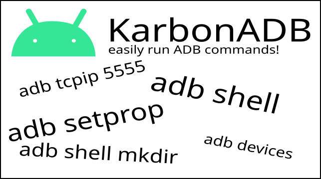

# KarbonADB

<p align="center">
 
</p>

<p align="center">
 
</p>

A TurboWarp (scratch mod) extension that lets your project talk to a Meta Quest (or any Android device) over **ADB on TCP/IP**: run shell commands, manage files and folders, install APKs, and read or write system properties, all from blocks.

> **Status:** experimental. The ADB protocol, auth and sync layers are implemented from scratch and have not been widely tested. Expect rough edges.

## How it works

Browsers can't open raw TCP sockets, so KarbonADB connects through a tiny local **WebSocket-to-TCP bridge** (`bridge.js`) that forwards traffic to the device's ADB port.

```
TurboWarp (KarbonADB)  --ws-->  bridge.js  --tcp-->  headset :5555 (adbd)
```

Everything else (the ADB packet protocol, RSA authentication, shell streams, file push/pull) runs inside the extension with no external libraries.

## Files

| File | Purpose |
| --- | --- |
| `karbonadb-extension.js` | The TurboWarp extension (load as **unsandboxed**) |
| `bridge.js` | Node.js WebSocket-to-TCP bridge |

## Requirements

- TurboWarp (desktop app, or the web editor with custom extensions loaded unsandboxed)
- Node.js 16+ for the bridge
- A headset with developer mode on and ADB listening on TCP

## Setup (PC)

1. **Enable ADB over TCP on the headset.** With the headset connected by USB, run once:
   ```
   adb tcpip 5555
   ```
   This resets when the headset reboots.
2. **Start the bridge:**
   ```
   npm i ws
   node bridge.js
   ```
   It listens on `ws://127.0.0.1:8765`.
3. **Load the extension** in TurboWarp: *Add Extension > Custom Extension*, choose `karbonadb-extension.js`, and select **Run unsandboxed**.
4. **Connect** from your project:
   ```
   set IP to [192.168.1.50]
   set port to []            (empty = 5555)
   connect to headset
   ```
5. **Accept the prompt** inside the headset ("Allow debugging?"). Tick "Always allow" so it doesn't ask again. The generated key is stored in the browser's localStorage.

## Running entirely on the headset

The Quest Browser can't open TCP sockets either, so the bridge has to run on the headset:

1. Sideload **Termux** on the Quest.
2. In Termux: `pkg install nodejs`, then `npm i ws`, then `node bridge.js`.
3. In the extension, `set IP to 127.0.0.1` and connect.

The headset's own `adbd` must still be listening on TCP (see step 1 above). This path is untested.

## Blocks

| Block | What it does | ADB equivalent |
| --- | --- | --- |
| `connect to headset` | Opens the connection to the IP and port you set | `adb connect` |
| `disconnect headset` | Closes the connection | `adb disconnect` |
| `connected?` | True while the connection is open | no adb command |
| `last error` | Text of the most recent error, empty if none | no adb command |
| `set IP to (ip)` | Sets the device IP | no adb command |
| `set port to (port)` | Sets the port; empty uses `5555` | no adb command |
| `set bridge URL to (url)` | Changes the bridge address (default `ws://127.0.0.1:8765`) | |
| `run ADB command (command)` | Runs a command and reports its output | `adb shell ...` |
| `create folder (name) in (path)` | Creates a folder | `mkdir -p` |
| `create file (name) in (path)` | Creates an empty file | `touch` |
| `write (data) to file (path)` | Writes text to a file (overwrites) | sync push |
| `remove file (name) in (path)` | Deletes a file | `rm -f` |
| `remove folder (path)` | Deletes a folder recursively | `rm -rf` |
| `remove folder (name) in (path)` | Same, with name and parent path | `rm -rf` |
| `read file (path)` | Reports the file contents | `cat` |
| `download file (path)` | Pulls the file and starts a browser download | `adb pull` |
| `choose APK file from computer` | Opens a file picker for the APK | no adb command |
| `install APK (apk) with (all/none) permissions` | Installs; `all` grants runtime permissions | `pm install -g` / `pm install` |
| `install APK (apk)` | Installs without granting permissions | `pm install` |
| `set property (prop) to (value)` | Sets a system property | `setprop` |
| `get property (prop)` | Reports a system property | `getprop` |

### Notes

- **`run ADB command`** accepts `shell ls /sdcard` or just `ls /sdcard`. `pull`, `push`, `install`, `connect`, `pair` and `disconnect` are rejected there; use the dedicated blocks.
- **APK source:** the `apk` field takes a URL. Leave it blank to use the file picked with `choose APK file from computer`.
- **`write ... to file`** uses ADB sync push, so quotes and special characters in your data are safe.
- **`download file`** can't choose a local folder; the browser saves it to its normal downloads location.
- Every action catches its own errors. Check `last error` instead of expecting the project to stop.

## Limitations

- **No `adb pair`.** Wireless-debugging pairing uses a TLS/SPAKE2 handshake that a browser extension can't perform. KarbonADB connects over plain `adb tcpip`, so the one-time USB step is required.
- Large files are pushed in 64 KB chunks and held in memory, so very large APKs may be slow.
- A reboot of the headset turns TCP ADB off again.

## Security

- The bridge binds to `127.0.0.1` only, but **any web page open in your browser could connect to it** and reach any host and port you can reach. Only run the bridge while you're using it.
- ADB access is full shell access to the device. Only connect to headsets you own.
- The RSA key used for authentication lives in your browser's localStorage. Clearing site data will make the headset ask to authorize you again.

## Troubleshooting

| Symptom | Likely cause |
| --- | --- |
| `Could not reach the WebSocket bridge` | `bridge.js` isn't running, or the bridge URL is wrong |
| `Timed out...` on connect | Wrong IP, `adb tcpip` not run, or the headset prompt wasn't accepted |
| `Device refused service` | The command or service isn't allowed on the device |
| `Not connected` | Run `connect to headset` first, or check `connected?` |
| Install reports a failure | Read `last error`; it contains the `pm install` output |
